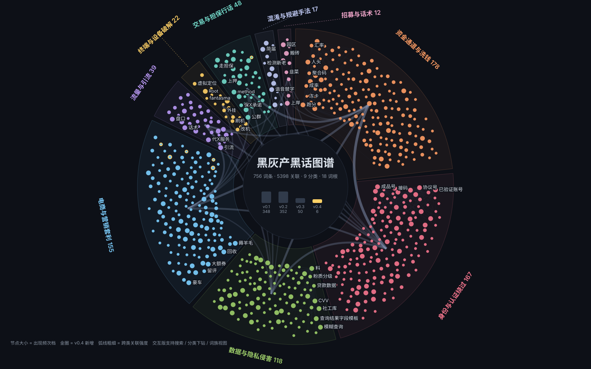
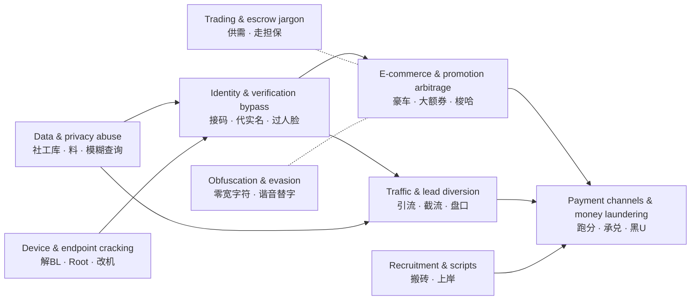

# Underground Slang Lexicon

**English** | [简体中文](README.zh-CN.md)

> A structured lexicon of underground and gray-market slang: definitions, sanitized real-world usage, **false-positive traps**, and supply-chain relations. Built for risk detection, content moderation, and security research.

<p align="center">
  <a href="https://www.threathunter.com">
    
  </a>
</p>

<p align="center">
  Maintained by the underground economy research team at <b><a href="https://www.threathunter.com">Threat Hunter (威胁猎人)</a></b><br>
  <i>See risk earlier. Act with context.</i><br>
  <sub><a href="https://www.threathunter.com">English</a> ｜ <a href="https://www.threathunter.cn">中文站</a></sub>
</p>

[](dict/黑话词典.md)
[](dict/黑话词典.md)
[](dict/黑话词典.md#非中文词条索引)
[](dict/黑话词典.md)
[](LICENSE)

**👉 [Browse the lexicon](dict/黑话词典.md)** ｜ [CSV](dict/terms.csv) ｜ [Structured data](data/entries/) ｜ [Schema](data/schema.json) ｜ **[Relation graph](https://threathunterx.github.io/underground-slang-lexicon/)**

> **A note on language.** Headwords keep the language they are used in — mostly Chinese, plus Brazilian Portuguese, English, Indonesian, Tagalog and Vietnamese. Definitions, mechanisms and false-positive notes are written in Chinese, so the lexicon itself ([`dict/黑话词典.md`](dict/黑话词典.md)) reads in Chinese. Field names, values and the build tools are language-neutral.

---

## Relation graph

Three views of the whole lexicon. The **supply-chain overview** gives each of the nine categories a sector; arc width shows how strongly categories link to each other, and the center tracks growth by release. The **category drill-down** opens a category's subgraph when you click its sector, with semi-transparent outer nodes for cross-category links. The **morphological families** view is a sunburst of word roots that shows at a glance how the slang is built. Entries circled in yellow come from the latest release.



**[Open the interactive version](https://threathunterx.github.io/underground-slang-lexicon/)** — search, drill down by category, click a node to see its definition and related entries, tune edge density, and drag nodes around. The data is inlined and works offline: after cloning, just open `docs/index.html`.

> If the link above isn't live yet, use the [mirror link](https://htmlpreview.github.io/?https://raw.githubusercontent.com/threathunterX/underground-slang-lexicon/main/docs/index.html) (a third-party raw-file proxy that follows every commit to this repository).

The graph is rebuilt from entry data by [`tools/build_viz.py`](tools/build_viz.py). The layout seed is fixed, so builds are deterministic, and the word-root table comes from the same source as `build_dict.py`. When you submit entries, commit the regenerated `docs/` along with them.

---

## Background

Defenders and attackers don't speak the same language. Risk rules say "bulk registration" and "fake transactions"; the underground itself says 一条龙 (end-to-end service), AB单 (two-step order brushing), 包批 (guaranteed loan approval) and 实卡接码 (verification codes received on real SIM cards). That vocabulary gap is the first barrier: if you can't tell what is being said, you can't detect it, collect evidence, or act on it.

This lexicon pins that vocabulary down. Each entry gives a definition, its position in the supply chain, sanitized real-world usage, and **what the word means in ordinary contexts**. That last part usually takes more work than the other three, and it decides whether the lexicon can go straight into rules: most hits on 空包 (empty parcels shipped to fake transactions) are vacuum packaging, most hits on 养卡 (card nurturing) are car maintenance cards, and 放量 (releasing a large batch of payouts) nearly always turns out to be part of 播放量 (play count). Leave that out, and a rule goes live as a flood of false positives.

Entries come from Threat Hunter's ongoing monitoring and analysis of the underground economy. The definitions and false-positive notes in `v0.1` were reviewed by hand, entry by entry; `v0.2` is still under review. The `first_seen` field tells the batches apart, and `v0.2` entries are marked `to-verify` while their fields are being filled in.

Threat Hunter is built on underground-economy intelligence and serves teams in finance, internet, e-commerce, consumer and global business. This lexicon is one face of that capability: **pinning down the jargon we keep running into, and making it public**.

## The problem it solves

Anyone who works in risk control, moderation or intelligence analysis has hit the same wall: **you can read every word and still not understand the sentence.**

> 供 ： 〔某品牌〕卡核销 需要d
>
> 豪车必拉满，货号：〔已脱敏〕
>
> 大额券+消费券到手 286，回收端 389 分钟卖
>
> 拍 1 发 2 包，实符 64 亓

Roughly: "Offering [brand] card redemption — DM if you need it." / "High-margin deal, max it out; item no. [redacted]." / "Big coupon plus voucher brings the cost to 286; the recycler pays 389 and it sells within minutes." / "Order 1, ships 2 packs; actual payment 64 yuan" — with 实符 and 亓 standing in for 实付 (amount paid) and 元 (yuan) to slip past keyword filters.

None of this is gibberish. It is precise, efficient trade language with clear referents. Without it, intelligence is just text; with it, you can tell where an ad sits in the supply chain and what happens next.

## How it differs from a "risk keyword list"

| | Risk keyword list | This lexicon |
| --- | --- | --- |
| Content | Word + risk level | Word + definition + mechanism + real usage + **false-positive notes** + related terms |
| Organization | Flat | Nine categories by supply-chain position, plus 18 morphological families by word root |
| Ambiguity | Not handled | Ordinary-context meanings and observed false-positive sources (<!--n_amb-->466<!--/n_amb--> entries so far) |
| Obfuscated spellings | Usually left out | **A category of their own** — the most discriminative features there are |
| Usage | Alert on any hit | Separates high-precision rules from low-discrimination words that need combined signals |

**The key difference is the false-positive notes.** <!--n_amb-->466<!--/n_amb--> of the <!--n_all-->772<!--/n_all--> entries carry one (<!--p_amb-->60<!--/p_amb-->%), because a great deal of slang is written exactly like everyday language:

- 养卡 is overwhelmingly a car **maintenance card**
- 空包 hits come mainly from **vacuum packaging**
- 四件套 is mostly a **four-piece bedding set**
- 开盒 (doxxing) is mostly **unboxing videos**
- 模糊 (fuzzy person lookup) is mostly the database **LIKE fuzzy query**
- Many people who mention 刷单 (order brushing) are **victims**, not perpetrators

> **The v0.2 batch is still being filled in.** Of the <!--n_v2-->352<!--/n_v2--> entries that release added from a separate collection, <!--n_tv_v2-->352<!--/n_tv_v2--> are still `confidence: to-verify`.
> `mechanism` is filled in for <!--n_mech_v2-->142<!--/n_mech_v2--> of them (<!--p_mech_v2-->40<!--/p_mech_v2-->%) and false-positive notes cover <!--p_amb_v2-->28<!--/p_amb_v2-->%,
> both below the <!--n_v1-->348<!--/n_v1--> v0.1 entries (`mechanism` <!--p_mech_v1-->100<!--/p_mech_v1-->%, false-positive notes <!--p_amb_v1-->85<!--/p_amb_v1-->%),
> which is why coverage across the whole lexicon is diluted to <!--p_amb-->60<!--/p_amb-->% for now. Use the `first_seen` field to tell the batches apart:
> v0.1 has been reviewed, v0.2 is pending review. Help filling the gaps is welcome — see [Updates and contributing](#updates-and-contributing).

Dropping these words straight into risk rules buys you a pile of false positives and wrongly flagged users. Explaining that part well is worth more than collecting a hundred more words.

## Underground text has an "obfuscation layer"

The jargon is routinely rewritten to defeat keyword detection, and the techniques are standardized and enumerable:

| Technique | Example |
| --- | --- |
| Zero-width characters | `一⁠天稳​赚` (invisible separators) |
| Homophone and look-alike substitution | `亓`→元, `实符`→实付, `订丹`→订单, `项木`→项目 |
| Variant and Japanese kanji forms | `単`→单, `啇`→商, `寳`→宝 |
| Moving contact details off the post | The body only says "see the **简届** (bio) for details"; the contact lives in the profile |
| Emoji as characters and units | `💰折17.5🉐500ml`, `300🥩` |
| Visible spaces inside words | `手 机号` |

There is a twist here, and it translates directly into detection capability:

> **`实符`, `简届`, `简阶`, `虹包` and `项木` are not words in standard Chinese. A hit almost certainly means text rewritten to evade detection.**

The effort adversaries spend rewriting text to dodge keyword filters leaves behind a feature that is cleaner than the original word. Deploy this class of terms separately, as **high-precision rules**.

## Nine categories along the supply chain



| Category | Entries | Position in the chain |
| --- | --- | --- |
| [Data & privacy abuse](dict/黑话词典.md#数据与隐私侵害) | <!--cat:数据与隐私侵害-->118<!--/cat:数据与隐私侵害--> | Upstream: raw identity and communications data |
| [Identity & verification bypass](dict/黑话词典.md#身份与认证绕过) | <!--cat:身份与认证绕过-->170<!--/cat:身份与认证绕过--> | Turns data into usable accounts |
| [Device & endpoint cracking](dict/黑话词典.md#终端与设备破解) | <!--cat:终端与设备破解-->23<!--/cat:终端与设备破解--> | Gives accounts a trusted device environment |
| [E-commerce & promotion arbitrage](dict/黑话词典.md#电商与营销套利) | <!--cat:电商与营销套利-->163<!--/cat:电商与营销套利--> | Monetization: platform subsidies and perks |
| [Traffic & lead diversion](dict/黑话词典.md#流量与引流) | <!--cat:流量与引流-->39<!--/cat:流量与引流--> | Monetization: steering traffic to gambling, fraud and porn |
| [Payment channels & money laundering](dict/黑话词典.md#资金通道与洗钱) | <!--cat:资金通道与洗钱-->178<!--/cat:资金通道与洗钱--> | Downstream: cashing out and laundering proceeds |
| [Trading & escrow jargon](dict/黑话词典.md#交易与担保行话) | <!--cat:交易与担保行话-->51<!--/cat:交易与担保行话--> | Support: market rules for trading resources |
| [Obfuscation & evasion](dict/黑话词典.md#混淆与规避手法) | <!--cat:混淆与规避手法-->18<!--/cat:混淆与规避手法--> | Support: defeating detection |
| [Recruitment & scripts](dict/黑话词典.md#招募与话术) | <!--cat:招募与话术-->12<!--/cat:招募与话术--> | Support: labor supply |

There is also a **[morphological family index](dict/黑话词典.md#构词法词族)** organized by word root (18 roots: `料`/`鱼`/`码`/`号`/`卡`/`车`/`粉`/`盘`/`户`/`单`/`商`/`群`/`水`/`口`/`代X`/`保X／包X`/`无视X`/`反X`). Categories show where a word sits in the supply chain; roots show how the language generates words. The roots are more useful over time: new words tend to follow the same patterns, so knowing which root a word belongs to tells you roughly where it sits in the chain.

**By language** ([non-Chinese index](dict/黑话词典.md#非中文词条索引)): <!--langs-->Chinese 670 · English 38 · Brazilian Portuguese 36 · Indonesian 10 · Vietnamese 7 · Tagalog 11<!--/langs-->. Non-Chinese entries share the same categories, with `lang` and `region` marking the language and the ecosystem where the word circulates.

Of the <!--n_edge-->5442<!--/n_edge--> relations (all bidirectional), <!--n_cross-->1837<!--/n_cross--> cross categories, and no entry is isolated. The most connected hubs are <!--hubs-->**跑分**, **成品号**, **料**, **公群**, **协议号**, **人头**<!--/hubs-->.

The same jargon spans e-commerce, finance, local services and social platforms, and it spans languages too. Escrow is 走担保 in Chinese, escrow in English and trung gian in Vietnamese. Accounts that receive the money are 公户 / 车队 in Chinese, drop in English, cho thuê bank in Vietnamese and jasa rekening in Indonesian.

## What an entry looks like

```json
{
  "id": "mohu",
  "term": "模糊查询",
  "aka": ["模糊找人", "整合模糊", "模糊机主"],
  "category": "数据与隐私侵害",
  "definition": "在只掌握部分信息（如地区、姓名、户籍地）的情况下，反查特定自然人完整身份与联系方式的服务。",
  "mechanism": "面向'只知道一点线索也能找到人'的需求，是开盒与定向骚扰的关键能力；按线索完整度与返回字段计价。",
  "example": "模糊查找（提供 地区、姓名、户籍地）",
  "ambiguity": "'模糊查询'在数据库与检索技术中是标准概念（LIKE 查询），技术文档大量出现，是高误报词，须结合'机主、找人、户籍'等共现词判定。",
  "related": ["shegongku", "kaihe", "haomazhuangtai", "liao", "siyaosu"],
  "confidence": "high",
  "frequency": "常见"
}
```

This entry describes a "fuzzy lookup" service: finding a specific person's full identity and contact details from partial information such as region, name or place of household registration. Its `ambiguity` field warns that "fuzzy query" is a standard database concept (`LIKE`), so it only counts as slang next to words like 机主 (account holder), 找人 (find someone) or 户籍 (household registration).

### Field reference

| Field | Shown in the lexicon as | Meaning | Required | Format and checks |
| --- | --- | --- | --- | --- |
| `id` | Not shown | Stable identifier that `related` uses to point at entries | Yes | Lowercase Latin letters, pinyin or hyphens; never changes after release; duplicates are blocked |
| `term` | Entry title | The headword — the most common spelling | Yes | Prefer the form actually in use. Only techniques without a common name get a descriptive title, and then `aka` must list the searchable forms that really occur; duplicates are blocked |
| `aka` | 又作 (also written) | Synonyms, variants, homophone spellings, abbreviations | No | Searchable variants only; mappings such as `利闰=利润` go in `mechanism`. An alias may belong to only one entry and may not match another entry's title |
| `category` | The category section it appears in | One of the nine categories | Yes | Must be one of the nine |
| `lang` | Language tag under the title | Language of the entry | No | Defaults to Chinese; allowed values are under `languages` in `data/schema.json` |
| `region` | Ecosystem tag under the title | Region or ecosystem where the word circulates | No | e.g. 巴西外卖与网约车生态 (Brazilian food-delivery and ride-hailing ecosystem) |
| `definition` | 释义 (definition) | One sentence on what the word means | Yes | No evaluative wording; must not open with the term itself; under 15 characters triggers a notice |
| `mechanism` | 在链条中的作用 (role in the chain) | What it does in the underground supply chain, upstream and downstream | No | Mechanisms only — no operational steps, no restating the definition; a missing value triggers a notice |
| `example` | 示例（脱敏） (sanitized example) | How it is used in a real setting | No, strongly recommended | Must be sanitized: platforms, brands, contact details, links and item numbers are replaced or removed; scanned entry by entry at build time |
| `example_note` | 无示例说明 (why there is no example) | Why no publishable example could be found | No | Fill it in when there is no `example` instead of leaving the gap silent |
| `ambiguity` | 歧义与误报 (ambiguity and false positives) | What the word means in ordinary contexts — where false positives come from | No, strongly recommended | State the everyday meaning and which co-occurring words make it slang; a missing value triggers a notice |
| `related` | 关联 (related) | `id`s of related entries | No | Must be symmetric; no self-references, duplicates or dangling ids |
| `confidence` | 研判置信度 (confidence) | How certain the judgment is | Yes | `high` / `medium` / `to-verify`; see [Quality standards](#quality-standards) |
| `frequency` | 出现频次 (frequency) | Frequency band of the word in our monitoring corpus | No | 常见 (common) / 较常见 (fairly common) / 少见 (rare); for prioritizing rules, **not** a measure of risk |
| `first_seen` | 收录版本 (release) | Release in which the entry first appeared | No | e.g. `v0.1` |

Rules marked "blocked", "must" or "only" are enforced by `tools/build_dict.py` at build time: the lexicon won't build until they pass. A "notice" is only a reminder and doesn't block a submission.
The machine-readable schema is [`data/schema.json`](data/schema.json).

## How to use it

**Look up words**: read [`dict/黑话词典.md`](dict/黑话词典.md) (in Chinese), browse by category or word root, or search the full text.

**Integrate with your systems**: use [`dict/terms.csv`](dict/terms.csv), or read the JSON under [`data/entries/`](data/entries/) directly. Deploy in tiers by `confidence`, `ambiguity` and `frequency`:

- Obfuscated spellings with no false-positive notes and `confidence: high` (`实符`, `简届`, `亓`) → usable as high-precision rules that alert on a hit
- Words with false-positive notes → need combined signals; a single hit is not enough
- Single characters and Latin letters (`料`, `d`, `出`/`收`) → match fixed phrase patterns only (`需要d`, `大量收X`), never the bare word
- **Entries with descriptive titles** (`入口指引`, `店铺规格语法`, `代X服务`, `保X承诺`, `防风控操作` and others) → these techniques have no common name in the wild, so the title is ours; build rules from the forms listed in `aka`, not from the title
- `frequency` is the word's frequency band in our monitoring corpus (common / fairly common / rare), for prioritizing rules — **not a measure of risk**

**Build it yourself**: after editing `data/entries/`, run validation and generation.

```bash
python3 tools/build_dict.py    # validate entries, regenerate the lexicon and CSV
python3 tools/check_links.py   # check internal links and anchors in the docs
```

No third-party dependencies.

## Quality standards

- **Three confidence levels**:
  - `high`: the meaning is supported by real usage and confirmed by human review
  - `medium`: the meaning is largely settled, but usage varies or the boundaries are unclear — interpret it in context
  - `to-verify`: insufficient evidence, or not yet reviewed entry by entry; everything merged in v0.2 sits here while review continues

  <!--n_tv-->434<!--/n_tv--> entries are currently marked to-verify.
- **When unsure, we say so instead of giving a confident-looking wrong definition.** A word whose meaning the evidence can't settle is better left out than forced.
- **Every example is sanitized**: <!--n_ex-->643<!--/n_ex--> entries carry real usage; the
  <!--n_note-->117<!--/n_note--> without a publishable example explain why in `example_note` (nearly every hit on 空包, for instance, is 真空包装 — vacuum packaging — which is itself the false-positive source).
- **Automatic checks at build time** — the lexicon won't build if any of them fails:
  - Structure: unique ids and titles, no alias conflicts, symmetric relations, no dangling references
  - **Sanitization**: every prose field (definition, mechanism, ambiguity, example and the rest) is scanned for real identifiers — phone numbers, ID numbers, wallet addresses, account handles, links, business names, named platforms and banks — and for any information about corpus size
  - Generated files in sync with the source data

## Updates and contributing

The lexicon is updated continuously, with incremental releases. Corrections to any definition and new words are welcome — see [`CONTRIBUTING.md`](CONTRIBUTING.md) (in Chinese) and the issue templates.

When you submit a new entry, two things matter: **include a sanitized real-world example**, and **fill in the false-positive notes**. Entries missing either are unlikely to be accepted.

## Disclaimer

This lexicon is for security research, risk detection and public education. Every entry **describes language and mechanisms only, and provides no operational guidance**. Examples are sanitized.

Platform categories and industry names that appear in entries **do not imply wrongdoing by any party** — the platforms being abused are the ones bearing the risk. This lexicon makes no allegation that any named company, brand or individual takes part in the underground economy.

No one may use this lexicon for unlawful purposes.

## Maintainers and citation

This lexicon is maintained and continuously updated by the underground economy research team at **Threat Hunter (威胁猎人)**.
Website: [threathunter.com](https://www.threathunter.com) (English) ｜ [threathunter.cn](https://www.threathunter.cn) (Chinese).
Operated by 深圳永安在线科技有限公司.

Open-source projects from Threat Hunter:

| Project | Description |
| --- | --- |
| [Nebula 星云](https://github.com/threathunterX/nebula2) | Open-source business risk-control system with Flink real-time computation and built-in strategies |
| [IP99 SDK](https://github.com/threathunterX/ip99-sdk) | SDK for IP risk profiling |

**Please point out any wrong definition.** This lexicon is only as valuable as its judgments are accurate; corrections matter more than additions.

Suggested citation:

```
Threat Hunter Underground Economy Research Team. Underground Slang Lexicon [DB/OL].
https://github.com/threathunterX/underground-slang-lexicon
```

## License

This repository is dual-licensed:

| Content | License | File |
| --- | --- | --- |
| Entry data (`data/`, `dict/`) | [CC BY 4.0](https://creativecommons.org/licenses/by/4.0/) | [`LICENSE`](LICENSE) |
| Scripts (`tools/`) | MIT | [`LICENSE-MIT`](LICENSE-MIT) |

Entry data may be freely copied, adapted and used commercially, **with attribution** (see the citation format above).
