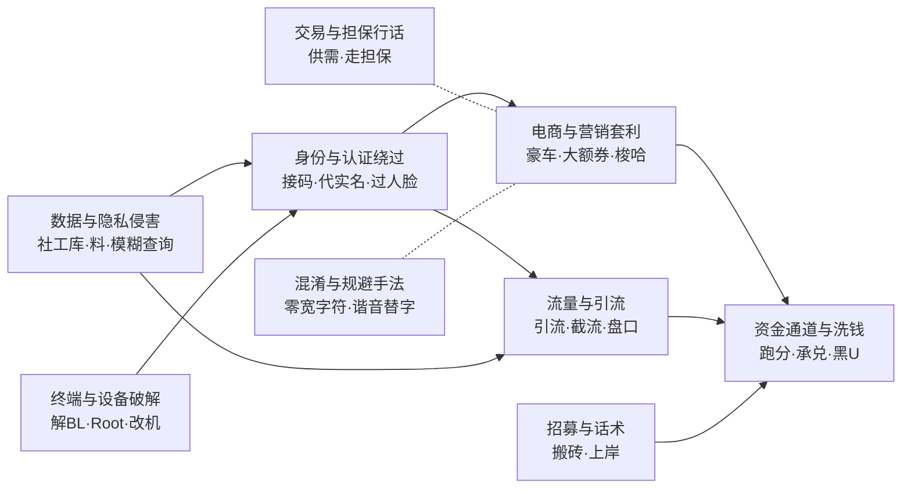

# 互联网黑灰产黑话词典

> 黑灰产行话的结构化词典：释义、脱敏真实用例、**误报陷阱**与产业链关联。面向风险识别、内容审核与安全研究。

> **Underground Slang Lexicon** — a structured reference for the jargon of the Chinese-language online fraud and gray-market economy: definitions, sanitized real-world usage, **false-positive warnings**, and supply-chain relations. Chinese-dominant, with Brazilian Portuguese, English, Indonesian, Tagalog and Vietnamese cross-references.

<p align="center">
  <a href="https://www.threathunter.cn">
    
  </a>
</p>

<p align="center">
  由 <b><a href="https://www.threathunter.cn">威胁猎人 Threat Hunter</a></b> 黑灰产研究团队维护<br>
  <i>先看见再行动 ｜ See risk earlier. Act with context.</i><br>
  <sub><a href="https://www.threathunter.cn">中文站</a> ｜ <a href="https://www.threathunter.com">English</a></sub>
</p>

[](dict/黑话词典.md)
[](dict/黑话词典.md)
[](dict/黑话词典.md#非中文词条索引)
[](dict/黑话词典.md)
[](LICENSE)

**👉 [直接查看词典](dict/黑话词典.md)** ｜ [CSV 下载](dict/terms.csv) ｜ [结构化数据](data/entries/) ｜ [字段规范](data/schema.json)

---

## 项目背景

防守方和攻击方用的不是同一套词汇。风控规则里写的是「批量注册」「虚假交易」，
而黑灰产自己说的是「一条龙」「AB 单」「包批」「实卡接码」。这层词汇差是对抗里的第一道门槛——
看不懂在说什么，就谈不上识别、取证与处置。

这个词典做的就是把这层词汇固定下来：每个词给出释义、它在产业链里的位置、
脱敏后的真实用例，以及**它在正常语境下是什么意思**。最后一项往往比前三项更费工夫，
也更决定这份词典能不能直接拿去做规则——「空包」的多数命中是真空包装，
「养卡」的多数命中是汽车小保养卡，「放量」几乎都是「播放量」的一部分。
不说清这些，一条规则上线就是一片误报。

词条来自威胁猎人持续的黑灰产监测与研判，释义与歧义说明由人工逐条核实。
按 `first_seen` 可以区分两批：`v0.1` 已复核，`v0.2` 标 `to-verify`、仍在补字段。

威胁猎人以黑灰产情报为底层核心能力，服务金融、互联网、电商、消费与全球化业务团队。
这份词典是那套情报能力的一个侧面——**把对抗中反复遇到的行话固定下来，公开出来**。

## 这个词典解决什么问题

做风控、审核和情报分析的人都遇到过同一件事：**看得懂每个字，读不懂这句话。**

> 供 ： 〔某品牌〕卡核销 需要d
>
> 豪车必拉满，货号：〔已脱敏〕
>
> 大额券+消费券到手 286，回收端 389 分钟卖
>
> 拍 1 发 2 包，实符 64 亓

这些都不是乱码，是精确、高效、有明确所指的行业语言。不懂这套语言，情报就只是文本；懂了，才能看出一条广告在产业链的哪个位置、下一步会发生什么。

## 和普通"风险词表"的区别

| | 风险词表 | 本词典 |
| --- | --- | --- |
| 内容 | 词 + 风险等级 | 词 + 释义 + 机制 + 真实用例 + **歧义说明** + 关联词 |
| 组织方式 | 平铺 | 按产业链位置分九类，另按语素分 18 个构词法词族 |
| 歧义处理 | 无 | 标注正常语境下的含义与实测误报来源（已覆盖 <!--n_amb-->371<!--/n_amb--> 条） |
| 混淆写法 | 一般不收 | **专门成类**，是判别力最高的一批特征 |
| 用法 | 命中即告警 | 区分高精度规则与需组合判定的低判别力词 |

**最关键的差异是"歧义说明"。** <!--n_all-->700<!--/n_all--> 条词条中 <!--n_amb-->371<!--/n_amb--> 条标注了歧义（<!--p_amb-->53<!--/p_amb-->%），因为大量黑话的字面形式与正常用语完全重合：

- "养卡"绝大多数是汽车**小保养卡**
- "空包"的主要命中来源是**真空包装**
- "四件套"大多是**床品四件套**
- "开盒"大多是**开箱评测**
- "模糊"大多是数据库的 **LIKE 模糊查询**
- 提及"刷单"的人，很多是**受害者**而不是加害者

> **v0.2 批次仍在补字段。** 本版新增的 <!--n_v2-->352<!--/n_v2--> 条来自另一批整理，其中 <!--n_tv_v2-->352<!--/n_tv_v2--> 条的 `confidence` 仍为 `to-verify`；
> `mechanism` 已补 <!--n_mech_v2-->140<!--/n_mech_v2--> 条（<!--p_mech_v2-->40<!--/p_mech_v2-->%），歧义说明覆盖 <!--p_amb_v2-->27<!--/p_amb_v2-->%，
> 都低于 v0.1 那 <!--n_v1-->348<!--/n_v1--> 条（`mechanism` <!--p_mech_v1-->100<!--/p_mech_v1-->%、歧义说明 <!--p_amb_v1-->79<!--/p_amb_v1-->%），
> 所以全库歧义覆盖率暂时被摊薄到 <!--p_amb-->53<!--/p_amb-->%。按 `first_seen` 字段可以区分两批：
> v0.1 是已复核的，v0.2 是待复核的。欢迎一起补齐，方式见 [更新与贡献](#更新与贡献)。

把这些词直接塞进风控规则，换来的是一堆误报和被冤枉的用户。词典把这部分讲清楚，比多收一百个词更有用。

## 黑灰产文本有一个"混淆层"

行话普遍经过一层针对关键词检测的改写，而且手法已经标准化、可枚举：

| 手法 | 例子 |
| --- | --- |
| 零宽字符插入 | `一⁠天稳​赚`（分隔符不可见） |
| 谐音形近替字 | `亓`→元、`实符`→实付、`订丹`→订单、`项木`→项目 |
| 异体字／日文汉字 | `単`→单、`啇`→商、`寳`→宝 |
| 联系路径外移 | 正文只留"看**简届**安排"，联系方式写在简介 |
| emoji 代字与计量 | `💰折17.5🉐500ml`、`300🥩` |
| 可见字符插空 | `手 机号` |

这里有个反转，也是可以直接变现为检测能力的点：

> **`实符`、`简届`、`简阶`、`虹包`、`项木` 在规范中文里都不成词。一旦命中，几乎可以确定是规避检测的改写文本。**

对手为躲开关键词检测而付出的改写成本，恰好留下了比原词更干净的特征。这类词应作为**高精度规则**单独部署。

## 九个分类与产业链位置



| 分类 | 词条 | 链条位置 |
| --- | --- | --- |
| [数据与隐私侵害](dict/黑话词典.md#数据与隐私侵害) | 116 | 上游：身份与通信数据原料 |
| [身份与认证绕过](dict/黑话词典.md#身份与认证绕过) | 158 | 把数据加工成可用账号 |
| [终端与设备破解](dict/黑话词典.md#终端与设备破解) | 22 | 为账号提供可信设备环境 |
| [电商与营销套利](dict/黑话词典.md#电商与营销套利) | 118 | 变现：平台补贴与权益 |
| [流量与引流](dict/黑话词典.md#流量与引流) | 39 | 变现：把流量导向赌诈色 |
| [资金通道与洗钱](dict/黑话词典.md#资金通道与洗钱) | 178 | 下游：收益落地与洗白 |
| [交易与担保行话](dict/黑话词典.md#交易与担保行话) | 41 | 支撑：资源交易的市场规则 |
| [混淆与规避手法](dict/黑话词典.md#混淆与规避手法) | 17 | 支撑：对抗检测 |
| [招募与话术](dict/黑话词典.md#招募与话术) | 11 | 支撑：人力供给 |

另有按语素组织的 **[构词法词族索引](dict/黑话词典.md#构词法词族)**（18 个词根：`料`/`鱼`/`码`/`号`/`卡`/`车`/`粉`/`盘`/`户`/`单`/`商`/`群`/`水`/`口`/`代X`/`保X／包X`/`无视X`/`反X`）——按分类看的是产业链位置，按词根看的是语言的生成规则。后者对持续使用更有用：新词往往沿着同样的构词法出现，看它属于哪个词根，就能大致判断它在链条上的位置。

**按语种**（[非中文词条索引](dict/黑话词典.md#非中文词条索引)）：中文 609 ｜ 英文 29 ｜ 葡萄牙语 36 ｜ 印尼语 10 ｜ 越南语 7 ｜ 他加禄语 9。非中文词条并入同一套分类，用 `lang` 与 `region` 字段标注语种与流通生态。

1,924 条关联边（全部双向）中有 644 条跨越分类，没有孤立词条。关联度最高的枢纽词是**跑分**、**引流**、**料**、**成品号**、**社工库**、**大额券**。

同一套行话横跨电商、金融、本地生活、社交多个行业，也横跨语言——担保交易在中文叫"走担保"、英文叫 escrow、越南语叫 trung gian；落地账户在中文叫"公户/车队"、英文叫 drop、越南语叫 cho thuê bank、印尼语叫 jasa rekening。

## 词条长什么样

```json
{
  "id": "mohu",
  "term": "模糊查询",
  "aka": ["模糊找人", "整合模糊", "模糊机主"],
  "category": "数据与隐私侵害",
  "definition": "在只掌握部分信息（如地区、姓名、户籍地）的情况下，反查特定自然人完整身份与联系方式的服务。",
  "mechanism": "面向'只知道一点线索也能找到人'的需求，是开盒与定向骚扰的关键能力；按线索完整度与返回字段计价。",
  "example": "模糊查找（提供 地区、姓名、户籍地）",
  "ambiguity": "'模糊查询'在数据库与检索技术中是标准概念（LIKE 查询），技术文档大量出现，是高误报词，须结合'机主、找人、户籍'等共现词判定。",
  "related": ["shegongku", "kaihe", "haomazhuangtai", "liao", "siyaosu"],
  "confidence": "high",
  "frequency": "常见"
}
```

字段规范见 [`data/schema.json`](data/schema.json)。

## 怎么用

**查词**：读 [`dict/黑话词典.md`](dict/黑话词典.md)，按分类或词根浏览，或全文搜索。

**接入系统**：用 [`dict/terms.csv`](dict/terms.csv) 或直接读 [`data/entries/`](data/entries/) 下的 JSON。建议按 `confidence`、`ambiguity` 与 `frequency` 分层部署——

- 无歧义说明 + `confidence: high` 的变形词（`实符`、`简届`、`亓`）→ 可作高精度规则，命中即告警
- 有歧义说明的词 → 必须组合判定，单独命中不足以定性
- 单字与字母词（`料`、`d`、`出`/`收`）→ 只能用固定句式模式（`需要d`、`大量收X`），不可单词检索
- **描述性标题的词条**（`入口指引`、`店铺规格语法`、`代X服务`、`保X承诺`、`防风控操作` 等 7 条）→ 这类手法在语料中没有统一名称，标题是本词典自拟的；建规则请用其 `aka` 里实际出现的形式，不要拿标题去匹配
- `frequency` 表示该词在监测语料中的出现频次（常见 / 较常见 / 少见），用于排规则优先级，**不代表风险高低**

**自己构建**：改完 `data/entries/` 后跑一次校验与生成。

```bash
python3 tools/build_dict.py    # 校验词条并重新生成词典与 CSV
python3 tools/check_links.py   # 检查文档内部链接与锚点
```

零第三方依赖。

## 词条质量口径

- **置信度分三档**：`high` / `medium` / `to-verify`。v0.1 的词条经真实用例回查确认；
  v0.2 并入的词条统一标 `to-verify`，仍在逐条复核。目前 <!--n_tv-->355<!--/n_tv--> 条标为待核实。
- **拿不准就标出来，不给一个看起来确定的错误释义。** 证据不足以判断词义的词，宁可不收也不硬写。
- **用例一律脱敏**：<!--n_ex-->570<!--/n_ex--> 条带真实用例；取不到可发布用例的
  <!--n_note-->118<!--/n_note--> 条用 `example_note` 写明原因（如「空包」的命中几乎全是「真空包装」，即其误报来源本身）。
- **构建时自动校验**，任何一项不过都无法生成词典：
  - 结构：id 与词条名唯一、别名不冲突、关联双向对称、不留悬空引用
  - **脱敏**：扫描释义、机制、歧义、用例等全部散文字段，拦截手机号、身份证号、钱包地址、
    账号 handle、链接、商号与具名平台银行等真实标识，以及任何语料规模信息
  - 生成物与源数据同步

## 更新与贡献

按版本增量更新。欢迎指出任何释义错误或补充新词——见 [`CONTRIBUTING.md`](CONTRIBUTING.md) 与 Issue 模板。

提交新词条时请注意两点：**必须附脱敏后的真实用例**，以及**必须填写歧义说明**。缺这两项的词条很难被采用。

## 免责声明

本词典用于安全研究、风险识别与公众教育。所有词条**仅描述语言现象与手法机制，不提供任何实施指导**。示例已脱敏处理。

词条中出现的平台类目、行业名称**不代表相关主体存在违规行为**——被滥用的平台是风险的承受方。本词典不对任何具名企业、品牌或个人作出参与黑灰产的指控。

任何人不得将本词典用于违法目的。

## 维护与引用

本词典由 **威胁猎人（Threat Hunter）** 黑灰产研究团队维护并持续更新。
官网 [threathunter.cn](https://www.threathunter.cn)（中文）｜ [threathunter.com](https://www.threathunter.com)（English）。
运营主体为深圳永安在线科技有限公司。

威胁猎人的开源项目：

| 项目 | 说明 |
| --- | --- |
| [星云 Nebula](https://github.com/threathunterX/nebula2) | 开源业务风控系统，Flink 实时计算与内置策略 |
| [IP99 SDK](https://github.com/threathunterX/ip99-sdk) | IP 风险画像开发工具包 |

**欢迎指出任何释义错误。** 这份词典的价值取决于判断准不准，纠错比新增更要紧。

引用建议：

```
威胁猎人（Threat Hunter）黑灰产研究团队．互联网黑灰产黑话词典［DB/OL］．
https://github.com/threathunterX/underground-slang-lexicon
```

## 许可

本仓库采用双许可：

| 内容 | 许可 | 文件 |
| --- | --- | --- |
| 词条数据（`data/`、`dict/`） | [CC BY 4.0](https://creativecommons.org/licenses/by/4.0/deed.zh) | [`LICENSE`](LICENSE) |
| 脚本（`tools/`） | MIT | [`LICENSE-MIT`](LICENSE-MIT) |

词条数据可自由复制、改编与商业使用，**须注明来源**（引用格式见上）。
